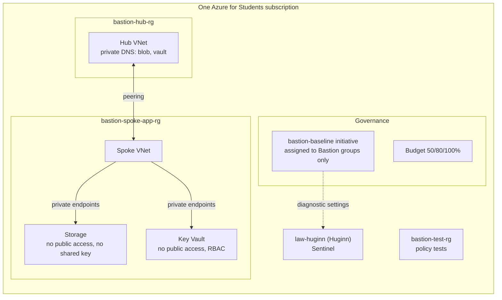

# Bastion

A small, secure-by-default Azure landing zone in Terraform: governance (management
groups, policy, budget), a hub-and-spoke network, private access to PaaS services, least
privilege, and a pipeline that proves the guardrails work by trying to break them.

> **Name:** this is the **Bastion landing zone**. It does not deploy Azure Bastion,
> Microsoft's paid jump-host service. See [ADR 0007](docs/adr/0007-no-firewall-gateway-or-azure-bastion-service.md).

**Bastion prevents, Huginn detects.** Bastion is one of three projects:

- [Fenrir](https://github.com/MarwenOnGit/fenrir): Azure managed-identity attack-path tool.
- [Huginn](https://github.com/MarwenOnGit/Huggin): Microsoft Sentinel detections for
  Fenrir's telemetry.
- **Bastion**: the guardrails that stop Fenrir's steps from working in the first place,
  and send logs to Huginn's workspace.

For every Fenrir operation, [PREVENT-DETECT.md](docs/PREVENT-DETECT.md) says whether
Bastion prevents it, Huginn detects it, or neither.

## Status (2026-11-03)

**Written and statically tested. Not yet deployed. Nothing is enforced yet.** Every policy
control is in its audit effect, and no policy test has run against Azure. Details, with
dates, in [STATUS.md](docs/STATUS.md).

| Check | Result |
|---|---|
| `terraform validate` (4 stacks), tflint, checkov, conftest verify | pass on GitHub Actions |
| pytest static checks (policies, Terraform, OIDC, workflows, docs, policy-test harness) | pass |
| Policy tests against Azure | not run (controls not yet in Deny) |

## Architecture



More diagrams (management groups, subnets, NSGs, pipeline) in
[ARCHITECTURE.md](docs/ARCHITECTURE.md).

## What gets deployed

| Stack | Contents | Run by |
|---|---|---|
| [infra/bootstrap](infra/bootstrap) | 4 resource groups, Entra-ID-only state storage, 3 GitHub OIDC identities with ID-based subjects, their roles, custom role "Bastion VM Operator", policy remediation identity, management groups `bastion` > `platform`, `landing-zones`, `sandbox` | you, on your laptop |
| [infra/governance](infra/governance) | `bastion-baseline` (16 built-ins, 2 custom copies), assignments on the Bastion groups, budget, Defender for Cloud free tier | `apply.yml`, approved by you |
| [infra/network](infra/network) | hub and spoke VNets, peering, an NSG on every subnet (explicit deny-all), private DNS zones | `apply.yml` |
| [infra/workload](infra/workload) | storage account and Key Vault, public access off, 2 private endpoints | `apply.yml`, for demos |

No public IPs, no VMs, no firewall, no gateways, no paid Defender plans.

## What is enforced

| Control | Target | Now | Test |
|---|---|---|---|
| Storage: no shared key access | Deny | Audit | not run |
| Storage: no public network access | Deny | Audit | not run |
| Key Vault: no public network access | Deny | Audit | not run |
| Container registry: no admin user | Deny | Audit | not run |
| App Service and Functions: SCM and FTP basic auth off | DeployIfNotExists | Disabled (audit control on) | compliance view |
| No public IPs on NICs | Deny | Audit | not run |
| Allowed locations | Deny | Audit | not run |
| Required tags `owner`, `env`, `project` | Deny | Audit | not run |
| Diagnostic settings to `law-huginn` | DeployIfNotExists | AuditIfNotExists | compliance view |

Full list with definition IDs: [POLICIES.md](docs/POLICIES.md). Azure Policy cannot block
actions such as Run Command or container exec; those are handled with RBAC
([ADR 0008](docs/adr/0008-rbac-for-actions-policy-cannot-block.md)).

## Pipeline

| Workflow | When | Azure identity |
|---|---|---|
| `ci.yml` | every push | none |
| `plan.yml` | push to `bastion-dev`, pull requests | `bastion-github-plan` (Reader) |
| `apply.yml` | manual, `main`, environment `bastion-apply` | `bastion-github-apply` |
| `drift.yml` | nightly | `bastion-github-plan` |
| `policy-tests.yml` | manual and nightly, environment `bastion-policy-tests` | `bastion-policy-tester` (Contributor on `bastion-test-rg` only) |

Every action is pinned to a commit SHA, every workflow starts with `permissions: {}`, and
no secret exists anywhere: Azure logins use OIDC only.

## Getting started

Follow [SETUP.md](docs/SETUP.md): bootstrap on your laptop, two GitHub environments,
repository variables, then apply one stack at a time.

Local checks (no Azure needed):

```bash
make test
```

## Cost

About **$1.50 a month** always on, plus about **$15 a month** while the workload stack
(two private endpoints) exists. Apply it for demos and destroy it after.
Details and the teardown commands: [COST.md](docs/COST.md).

Teardown in one line per stack (Actions > apply, operation `destroy`), then:

```bash
terraform -chdir=infra/bootstrap destroy
```

## Decisions

[docs/adr](docs/adr): resource groups instead of subscriptions, policy scope and
exclusions, Audit before Deny, built-in over custom, OIDC with ID-based subjects, CI
least privilege, no firewall or gateway, RBAC for what Policy cannot block.

## Roadmap

1. Phase 6: switch controls to Deny one at a time after the Audit results, each with its
   policy test turning green.
2. Diagnostic settings for App Service (X-11 detection) and file shares (D-02).
3. A custom Deny on `basicPublishingCredentialsPolicies` to block re-enabling basic auth.
4. Deployment stacks with deny settings, for a real deny on Run Command and exec.
5. With an Entra ID P1 licence: Conditional Access to block device code flow, PIM for
   Owner, and sign-in and Graph activity logs into Huginn.
6. Move the subscription under `bastion-landing-zones` once ADR 0001's check is done.

## Repository layout

```
infra/       bootstrap, governance, network, workload (Terraform)
policies/    initiative.json, effects.json, custom definitions
opa/         conftest rules for terraform plan JSON, with unit tests
tests/       policy (live Azure tests), static (pytest)
docs/        architecture, policies, prevent/detect, setup, status, cost, demo, ADRs
.github/     workflows
```
