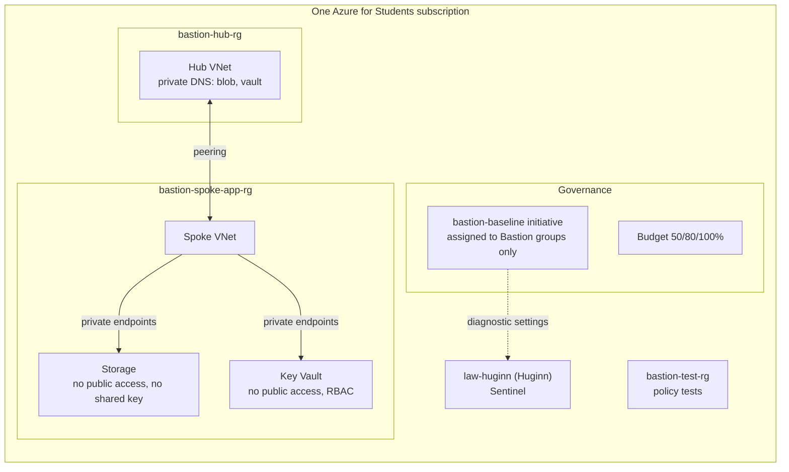

# Bastion

A small, secure-by-default Azure landing zone in Terraform: governance (a policy
initiative, a budget, a management group hierarchy), a hub-and-spoke network, private
access to PaaS services, least privilege, and a pipeline that proves the guardrails work
by trying to break them.

Scope, stated once and plainly: policy is assigned at resource group scope; the management group hierarchy is prepared but empty until ADR 0001's check is done.

> **Name:** this is the **Bastion landing zone**. It does not deploy Azure Bastion,
> Microsoft's paid jump-host service. See [ADR 0007](docs/adr/0007-no-firewall-gateway-or-azure-bastion-service.md).

**Bastion prevents, Huginn detects.** Bastion is one of three projects:

- [Fenrir](https://github.com/MarwenOnGit/fenrir): Azure managed-identity attack-path tool.
- [Huginn](https://github.com/MarwenOnGit/Huggin): Microsoft Sentinel detections for
  Fenrir's telemetry.
- **Bastion**: the guardrails that stop Fenrir's steps from working in the first place,
  and send logs to Huginn's workspace.

For every Fenrir operation, [PREVENT-DETECT.md](docs/PREVENT-DETECT.md) says whether
Bastion prevents it, Huginn detects it, or neither.

## Status (2026-11-04)

**Written and statically tested. Not yet deployed. Nothing is enforced yet.** Every policy
control is in its audit effect, and no policy test has run against Azure. Details, with
dates, in [STATUS.md](docs/STATUS.md).

| Check | Result |
|---|---|
| `terraform validate` (4 stacks), tflint, checkov, conftest verify | pass on GitHub Actions |
| pytest static checks (policies, Terraform, OIDC, workflows, docs, policy-test harness) | pass |
| conftest plan rules | 36 unit tests pass |
| Policy tests against Azure | not run (controls not yet in Deny) |

## Architecture



More diagrams (management groups, subnets, NSGs, pipeline) in
[ARCHITECTURE.md](docs/ARCHITECTURE.md).

## What gets deployed

| Stack | Contents | Run by |
|---|---|---|
| [infra/bootstrap](infra/bootstrap) | 4 resource groups, Entra-ID-only state storage, 3 GitHub OIDC identities with ID-based subjects, their roles, custom role "Bastion VM Operator", policy remediation identity, management groups `bastion` > `platform`, `landing-zones`, `sandbox` | you, on your laptop |
| [infra/governance](infra/governance) | `bastion-baseline` (21 controls: 23 built-ins, 6 custom definitions), assignments on the Bastion groups, budget, Defender for Cloud free tier and security contact | `apply.yml`, approved by you |
| [infra/network](infra/network) | hub and spoke VNets, peering, subnets declared with their NSG (explicit deny-all) and no default outbound access, private DNS zones | `apply.yml` |
| [infra/workload](infra/workload) | storage account and Key Vault, public access off, 2 private endpoints | `apply.yml`, for demos |

No public IPs, no VMs, no firewall, no gateways, no paid Defender plans.

## What is enforced

Nothing yet: every control is in its audit effect until its Audit results are reviewed
(Phase 6), and none has been tested against Azure. The 21 controls, grouped:

| Area | Controls | Target | Benchmark (MCSB v2) |
|---|---|---|---|
| Storage | no shared key, no public network access, HTTPS only, TLS 1.2, no anonymous blobs | Deny | IM-1, NS-2, DP-3 |
| Key Vault | no public network access, RBAC permission model, purge protection | Deny | NS-2, PA-7, DP-8 |
| Containers and apps | ACR admin user off; App Service and Functions SCM and FTP basic auth reported and turned off | Deny, DeployIfNotExists | IM-1 |
| Network | every subnet has an NSG, no default outbound access, no NIC public IP, no SSH or RDP from the internet | Deny | NS-1 (built-in twin) |
| Cost and exposure | no firewalls, gateways, Azure Bastion service, DDoS plans, public IPs or VMs | Deny | none |
| Governance | allowed locations, required tags `owner`, `env`, `project` | Deny | none |
| Logging | diagnostic settings to `law-huginn`; diagnostic settings cannot be deleted | DeployIfNotExists, DenyAction | LT-4 |
| Protection | resources tagged `bastion-protected` cannot be deleted | DenyAction | none |

Each enforcing control has a live test in [tests/policy](tests/policy) that passes only
when Azure refuses a deliberately bad request. Definition IDs, versions, MCSB and Azure
Landing Zones mapping: [POLICIES.md](docs/POLICIES.md). How the baseline compares with
Microsoft's reference: [ALZ-ALIGNMENT.md](docs/ALZ-ALIGNMENT.md).

Azure Policy cannot block actions such as Run Command or container exec: Deny judges
create and update requests, and DenyAction only supports delete. Those are handled with
RBAC ([ADR 0008](docs/adr/0008-rbac-for-actions-policy-cannot-block.md)).

## Pipeline

| Workflow | When | Azure identity |
|---|---|---|
| `ci.yml` | every push | none |
| `plan.yml` | push to `bastion-dev`, pull requests | `bastion-github-plan` (Reader) |
| `apply.yml` | manual, `main`, environment `bastion-apply` | `bastion-github-apply` |
| `drift.yml` | nightly: drift check and compliance report | `bastion-github-plan` |
| `policy-tests.yml` | manual and nightly, environment `bastion-policy-tests` | `bastion-policy-tester` (Contributor on `bastion-test-rg` only) |

Every action is pinned to a commit SHA, every workflow starts with `permissions: {}`, and
no credential exists anywhere: Azure logins use OIDC only. The single Actions secret is the
budget alert address, kept as a secret only so it is redacted from public logs.

## Getting started

Follow [SETUP.md](docs/SETUP.md): bootstrap on your laptop, two GitHub environments,
repository variables, then apply one stack at a time.

Local checks (no Azure needed):

```bash
make test
```

## Cost

About **$1.50 a month** always on, plus about **$15 a month** while the workload stack
(two private endpoints) exists. Apply it for demos and destroy it after.
Details and the teardown commands: [COST.md](docs/COST.md).

Teardown in one line per stack (Actions > apply, operation `destroy`), then:

```bash
terraform -chdir=infra/bootstrap destroy
```

## Decisions

[docs/adr](docs/adr): resource groups instead of subscriptions, policy scope and
exclusions, Audit before Deny (and why not `DoNotEnforce`), built-in over custom, OIDC with
ID-based subjects, CI least privilege, no firewall or gateway, RBAC for what Policy cannot
block, and why Bastion is hand-written instead of using the ALZ modules.

If you have several subscriptions, start from Microsoft's Azure Landing Zones accelerator
and Enterprise Policy as Code instead. Bastion is the small, explainable version for one
subscription, and maps each of its controls to the ALZ assignment that would replace it.

## Roadmap

1. Phase 6: switch controls to Deny one at a time after the Audit results, each with its
   policy test turning green.
2. Diagnostic settings for App Service (X-11 detection) and file shares (D-02).
3. A custom Deny on `basicPublishingCredentialsPolicies` to block re-enabling basic auth.
4. A Huginn rule on Bastion's policy denials (the query is in PREVENT-DETECT).
5. With an Entra ID P1 licence: Conditional Access to block device code flow, PIM for
   Owner, and sign-in and Graph activity logs into Huginn.
6. Move the subscription under `bastion-landing-zones` once ADR 0001's check is done.

## Repository layout

```
infra/       bootstrap, governance, network, workload (Terraform)
policies/    initiative.json, effects.json, custom definitions
opa/         conftest rules for terraform plan JSON, with unit tests
tests/       policy (live Azure tests), static (pytest)
docs/        architecture, policies, ALZ alignment, prevent/detect, setup, status, cost, demo, ADRs, blog
.github/     workflows
```
