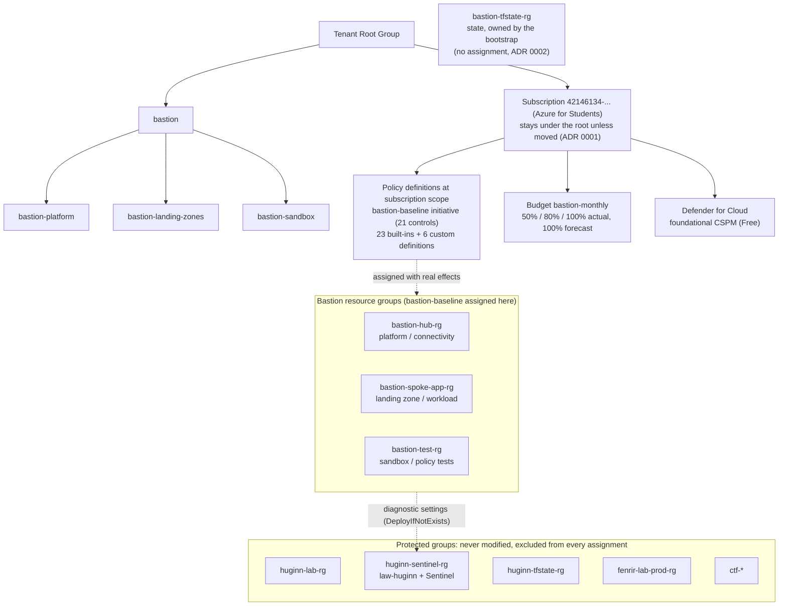
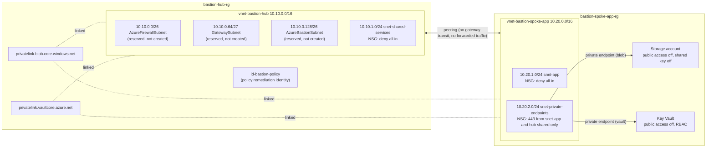
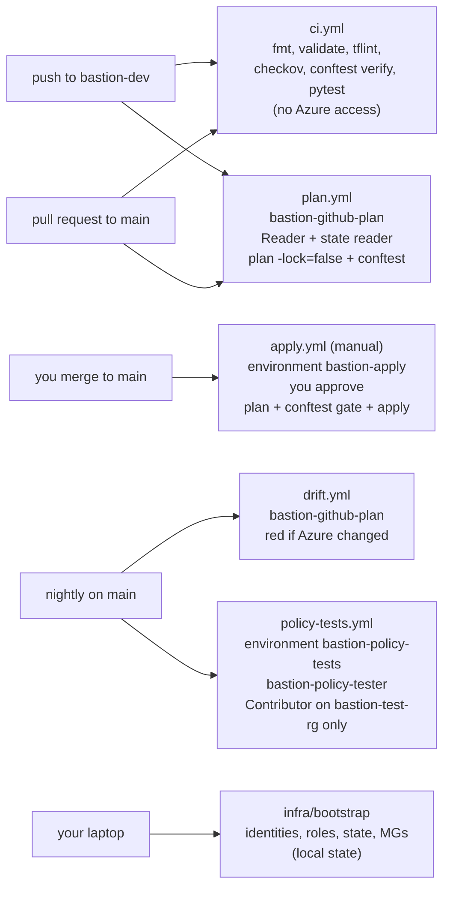

# Architecture

The Bastion landing zone in one subscription. This project does not deploy the Azure
Bastion service (Microsoft's jump-host product); "Bastion" here is the landing zone's name.

## Governance

## Network

No public IP exists anywhere. The internet cannot reach anything in Bastion, and the
workload's data services cannot be reached from the internet either.

### NSG rules

Every subnet has its own NSG. Every NSG ends in two explicit rules at priority 4096:
`deny-all-inbound` and `deny-all-outbound`. They make the intent visible and override
Azure's defaults (`AllowVnetInBound`, `AllowInternetOutBound`).

| NSG | Allowed (priority) | Why |
|---|---|---|
| `nsg-bastion-hub-shared-services` | out 443 to snet-private-endpoints (100) | reach the private endpoints |
| | out 443 to `AzureActiveDirectory` (110) | get Entra ID tokens |
| | out 443 to `AzureMonitor` (120) | send logs and metrics |
| `nsg-bastion-spoke-app` | same three outbound rules | same reasons |
| `nsg-bastion-spoke-private-endpoints` | in 443 from snet-app (100) and from hub shared services (110) | the only clients of the data services |

The PE subnet sets `private_endpoint_network_policies = "Enabled"` so these NSG rules
actually apply to private endpoint traffic.

Subnets are declared inline in each VNet with their NSG (`security_group`), not as separate
`azurerm_subnet` resources. A separate subnet is created first and associated with its NSG
afterwards, and in between it would violate the `subnet_nsg` control (Azure Landing Zones
`Deny-Subnet-Without-Nsg`). Every subnet also sets `default_outbound_access_enabled = false`
(the `subnet_private` control), so nothing in it can reach the internet through Azure's
implicit outbound IP.

Two things to know:

- Azure DNS (168.63.129.16) and the instance metadata service are platform traffic and are
  not affected by NSGs.
- `deny-all-inbound` also blocks the `AzureLoadBalancer` health probe. A load-balanced
  workload would need an allow rule for it.

### Where a firewall and a gateway would sit

See ADR [0007](adr/0007-no-firewall-gateway-or-azure-bastion-service.md). In a production
design, Azure Firewall goes in `AzureFirewallSubnet` with a 0.0.0.0/0 route from each
spoke, a VPN or ExpressRoute gateway goes in `GatewaySubnet`, and the spokes use remote
gateways through the peering.

## Delivery

All Azure logins use OIDC with ID-based subjects (ADR
[0005](adr/0005-oidc-with-id-based-subjects.md)). Roles are in ADR
[0006](adr/0006-ci-identities-and-least-privilege.md).

## Stacks and state

| Stack | Who runs it | State |
|---|---|---|
| `infra/bootstrap` | you, on your laptop | local file, git-ignored |
| `infra/governance` | `apply.yml` | `bastion-tfstate-rg` / `tfstate` / `governance.tfstate` |
| `infra/network` | `apply.yml` | `.../network.tfstate` |
| `infra/workload` | `apply.yml` | `.../workload.tfstate` |

The state account allows Entra ID only (shared keys disabled, no SAS, no anonymous blob
access, TLS 1.2), with blob versioning and 14-day soft delete. It keeps a public endpoint
because GitHub-hosted runners have no private path into the VNet; access depends on Entra
ID and the data role on the container. Its blob logs go to `law-huginn`.

Stacks do not read each other's state. The network and workload stacks find what they
need with data sources by name, and names are derived from the subscription ID.
