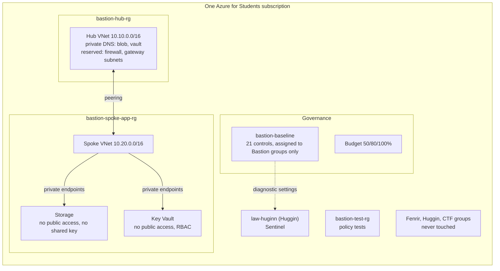

# Bastion: a secure-by-design Azure landing zone on a student subscription

*Bastion prevents, Huggin detects.*

> **Status, honestly:** everything in this post is written, statically tested and runs in
> CI. Nothing is deployed to Azure yet, and nothing is "enforced" until a policy test has
> passed against Azure. I will update this post with real results. The repository's
> `docs/STATUS.md` is the source of truth, with dates.

> **About the name:** "Azure Bastion" is a Microsoft product, a paid jump-host service.
> This project does not deploy it. In this post, "Bastion" always means my landing zone.

## TL;DR

- **What:** a small Azure landing zone in Terraform: management groups, a policy
  initiative with 21 controls, a budget, a hub-and-spoke network with private endpoints,
  least-privilege CI identities without a single secret, and five GitHub Actions
  workflows.
- **The twist:** every enforcing guardrail has a test that tries to break it. The test
  passes only if Azure answers `RequestDisallowedByPolicy` and names the expected policy.
  Every night.
- **Aligned with Microsoft's reference:** I compared each design decision with the Cloud
  Adoption Framework's Azure landing zone, the Azure Landing Zones policy library, the
  Microsoft cloud security benchmark (MCSB) v2 and Microsoft Learn, and changed the
  project where it fell short.
- **Constraints:** one Azure for Students subscription, 6 vCPUs per region, no Entra ID
  P1 licence, and three other projects living in the same subscription that must not be
  touched.
- **Cost:** about $1.50 a month always on, plus about $15 a month while the demo workload
  (two private endpoints) exists.

## Why I built it

I am a final-year computer engineering student at ENIT in Tunis, preparing a cloud
security internship whose projects must fit an Azure landing zone with a "Secure by
Design" approach. I already had two projects:

- **Fenrir**, my own tool that finds and walks managed-identity attack paths in Azure:
  enumerate what a user can reach, run commands on a VM to steal its identity's token,
  then use that token to list storage keys or registry credentials.
- **Huggin**, Microsoft Sentinel detections for Fenrir's telemetry, deployed with
  Terraform and validated with benign replays.

Huggin answers "would we see it?". The missing piece was "could we have stopped it?".
Bastion is that piece. For every one of Fenrir's 66 operations, the repository says
whether Bastion prevents it, Huggin detects it, or neither. The "neither" rows are the
most useful part.

## The constraints that shaped everything

| Constraint | Consequence |
|---|---|
| One subscription (Azure for Students) | Resource groups stand in for the subscriptions a real landing zone uses |
| Credit, not a company budget | No Azure Firewall, gateways, DDoS plan, Azure Bastion service or paid Defender plans. At most two private endpoints |
| 6 vCPUs per region | No VM in the always-on design |
| No Entra ID P1/P2 | No Conditional Access, no PIM, no sign-in logs in Log Analytics |
| Other projects in the same subscription | The Fenrir lab is *deliberately* insecure. A Deny policy there would break it |

That last one drove more design than anything else.

## What a landing zone is, in one table

Microsoft's Cloud Adoption Framework defines an Azure landing zone through eight design
areas. Here is how Bastion covers each one, compressed. The full comparison is in
[`docs/ALZ-ALIGNMENT.md`](../ALZ-ALIGNMENT.md).

| Design area | Bastion |
|---|---|
| Billing and tenant | Personal tenant, one subscription, budget with 50/80/100% alerts |
| Identity and access | OIDC only, three least-privilege CI identities, a custom role without Run Command |
| Resource organization | `bastion` > `platform`, `landing-zones`, `sandbox`; resource groups as subscriptions |
| Network topology | Hub and spoke, private DNS in the hub, private endpoints, NSG on every subnet |
| Security | Defender for Cloud free tier, every control mapped to MCSB v2 |
| Management | Logs to Huggin's workspace by policy; diagnostic settings cannot be deleted |
| Governance | 21 policy controls, built-ins first, Audit first, tested |
| Platform automation | Terraform, GitHub Actions, approvals, nightly drift and compliance |

A pleasant surprise: CAF has a page for exactly my situation, "Transition a single
subscription with no management groups to the Azure landing zone reference
architecture". It describes a single subscription with policy and RBAC assigned per
resource group as a normal starting state, and its migration path is to deploy the real
Azure landing zone in parallel, then move workloads into new subscriptions. That became
Bastion's roadmap.

## Architecture



Four Terraform stacks, each with its own state:

| Stack | Run by | Contents |
|---|---|---|
| `bootstrap` | me, once, on my laptop | resource groups, state storage, CI identities, roles, management groups |
| `governance` | CI, after my approval | policy, budget, Defender settings |
| `network` | CI | hub, spoke, NSGs, DNS |
| `workload` | CI, for demos | storage account, Key Vault, private endpoints |

## Governance: the decisions that matter

### 1. Real effects only on Bastion's own resource groups

The usual advice is to assign policy at management group scope. In this tenant, that
would cover the Fenrir lab. So:

- Policy **definitions** live at subscription scope (they do nothing until assigned).
- **Assignments with real effects** are made only at the three Bastion resource groups.
  A Terraform validation rejects any group not starting with `bastion-`, and a conftest
  rule rejects any plan that tries.
- An **optional subscription-wide assignment** exists for reporting only. Every effect is
  forced to its audit value, and every protected group is in `not_scopes`.
- `not_scopes` has no wildcards, so "every group starting with `ctf-`" cannot be expressed.
  Existing CTF groups are listed by name. Because that assignment is audit-only, the worst
  case for a new CTF group is a compliance report, never a blocked deployment.

### 2. Built-ins first, then Microsoft's own custom definitions, then mine

The initiative references **23 built-in definitions** and **6 custom ones**. Before
writing any custom definition, I looked for a built-in. Before writing my own, I looked in
the Azure Landing Zones library, which Microsoft maintains under the MIT licence:

- two ALZ definitions copied with attribution: "subnets must have an NSG" and "no
  management ports from the internet";
- one ALZ DenyAction definition with an effect parameter added;
- two copies of built-ins whose effect is fixed to Deny (more on that below);
- one DenyAction definition following an ALZ pattern.

Every built-in's GUID, name, version, allowed effects and parameter names were checked
against the source of the published definitions (the `Azure/azure-policy` repository),
not copied from a blog. Every control also records its **MCSB v2** control, read from
the `groupNames` that Microsoft itself puts in the MCSB v2 initiative:

| Area | Controls | MCSB v2 |
|---|---|---|
| Storage | no shared key, no public access, HTTPS only, TLS 1.2, no anonymous blobs | IM-1, NS-2, DP-3 |
| Key Vault | no public access, RBAC model, purge protection | NS-2, PA-7, DP-8 |
| Apps and registries | ACR admin user off, App Service basic auth reported and removed | IM-1 |
| Network | NSG on every subnet, no default outbound, no NIC public IP, no SSH/RDP from the internet | NS-1 |
| Cost and exposure | no firewalls, gateways, Azure Bastion service, DDoS plans, public IPs or VMs | none |
| Governance | allowed locations, required tags | none |
| Logging | diagnostic settings to Huggin's workspace, and they cannot be deleted | LT-4 |

"None" is an honest answer: MCSB v2 does not include that definition. It does not mean
the control is unrelated to security.

### 3. Audit first, and why not `DoNotEnforce`

Every control starts in its audit effect. A control moves to Deny only after I have read
its compliance results, in its own commit, which changes one line in
`policies/effects.json`. Its test switches on by itself.

Microsoft's own rollout mechanism is different: the assignment property
`enforcementMode: DoNotEnforce`, which Learn recommends "when you want to evaluate the
policy assignment before enforcement". The Azure Landing Zones library uses it. I chose
effect parameters instead, for three reasons:

1. **Granularity.** Enforcement mode belongs to an assignment. ALZ makes one assignment
   per guardrail, so it can stage each one. Bastion has one initiative, so a per-control
   parameter is the only per-control switch.
2. **Visibility.** Learn's table for enforcement modes says `DoNotEnforce` writes **no
   Activity log entry**. The Audit effect does
   (`Microsoft.Authorization/policies/audit/action`), and Huggin already collects that
   category. My Audit phase is visible in Sentinel.
3. **Two built-ins cannot start in Audit at all.** "Network interfaces should not have
   public IPs" and "Require a tag on resources" have their effect hard-coded to Deny. I
   copied them with the rule unchanged and an effect parameter added.

## The four things Azure Policy cannot do (and I first got wrong)

This section is the one I would have liked to read before starting.

**1. Deny only judges create and update requests.** Azure Policy's Deny effect looks at
the body of a PUT or PATCH. It never sees a POST to an action endpoint. So Policy cannot
stop VM Run Command, container exec, `listKeys` on a storage account or `listCredentials`
on a registry, which are exactly the actions Fenrir uses.

What Policy *can* do is make the result useless or remove the target:

- shared key access disabled: `listKeys` still returns keys, but storage rejects them;
- ACR admin user disabled: `listCredentials` returns nothing usable;
- "Not allowed resource types" with VMs on the list: there is no VM to run a command on.

**2. There is one action Policy can block: delete.** My first draft said "Policy cannot
block actions", full stop. Learn's page on the `denyAction` effect corrects that: "The
only supported action today is `DELETE`." Bastion now uses it twice, following ALZ:

- **Diagnostic settings cannot be deleted.** An attacker with Contributor cannot remove
  the log pipeline to blind Sentinel.
- **Resources tagged `bastion-protected` cannot be deleted.** This protects the managed
  identity that DeployIfNotExists policies run as; without it, remediation silently stops.

Some types are exempt from DenyAction on purpose (policy assignments, deny assignments,
deployment stacks, locks and subscriptions), so you cannot lock yourself out. And deleting
a parent still removes its children: deleting a Key Vault removes its diagnostic setting.

**3. NotActions is not a deny.** For Run Command and exec, the answer is RBAC: a custom
"Bastion VM Operator" role that can start, stop and restart, but whose `NotActions`
exclude `runCommand`, `extensions/write` (the Custom Script Extension is another way to
run code) and container `exec`. But `NotActions` only subtracts from *that role*. If the
same person also holds Contributor, Run Command works. That is why no human holds a
standing Contributor on the workload groups.

**4. You cannot write your own deny assignment (yet).** I had "use deployment stacks for
a real deny on Run Command" on my roadmap. Learn says customer-managed deny assignments
are in private preview, and deployment stack deny settings only offer `DenyDelete` and
`DenyWriteAndDelete`, which protect the stack's resources against changes. They do not
forbid Run Command. I took it off the roadmap and wrote down why.

## Network: one bug I caught by reading Microsoft's policy library

The network is classic hub and spoke, sized for the free tier:

- hub `10.10.0.0/16` with a shared-services subnet, and ranges **reserved but not created**
  for `AzureFirewallSubnet`, `GatewaySubnet` and `AzureBastionSubnet`, so a production
  version needs no renumbering;
- spoke `10.20.0.0/16` with an app subnet and a private-endpoint subnet;
- peering in both directions, no gateway transit, no forwarded traffic;
- private DNS zones for blob and vault in the hub, linked to both VNets;
- an NSG on every subnet ending in explicit `deny-all-inbound` and `deny-all-outbound`
  rules, with documented exceptions (443 to the private endpoints, Entra ID, Azure
  Monitor);
- `private_endpoint_network_policies = "Enabled"` on the PE subnet, so the NSG actually
  applies to private endpoint traffic;
- `default_outbound_access_enabled = false` on every subnet, so nothing reaches the
  internet through Azure's implicit outbound IP.

**The bug:** I first wrote each subnet as its own `azurerm_subnet` resource, with a
separate `azurerm_subnet_network_security_group_association`. That is the common
Terraform pattern. It also means that for a few seconds the subnet exists **without an
NSG**, and the ALZ policy "Deny-Subnet-Without-Nsg" denies exactly that request. With that
control in Deny, my own network stack would have failed to deploy.

The fix: declare subnets inline in `azurerm_virtual_network`, each with `security_group`
set, so every VNet request already carries the association. A conftest rule now rejects
standalone subnets, and a static test checks it. Reading Microsoft's policy library caught
a bug that no linter would have found.

A related subtlety in the conftest rule: at plan time a new NSG's ID is unknown, and
Terraform leaves unknown values out of the plan's `after` block. A naive "subnet has no
`security_group`" rule would have blocked the very first deployment. The rule only fires
on an explicit `null` or empty string, and a unit test covers the unknown case.

### The workload

A storage account and a Key Vault, both with public network access disabled and reachable
only through two private endpoints. Storage has shared keys disabled (Entra ID only), TLS
1.2, HTTPS only and no anonymous containers. Key Vault uses the RBAC permission model and
purge protection. One nuance worth knowing: with shared keys disabled, account and service
SAS tokens stop working, but a **user delegation SAS** (signed with Entra ID) still works
for anyone with the data role to create one.

## Identity: no secrets anywhere

GitHub Actions authenticates with **OIDC** (workload identity federation). There is no
client secret, certificate or storage key anywhere in the project.

One detail cost me a failed login before I understood it. GitHub's OIDC reference
describes **immutable subject claims**: repositories created after July 15, 2026 get
subjects that include the numeric owner and repository IDs:

```
repo:MarwenOnGit@183097322/Bastion@1444942400:environment:bastion-apply
```

A federated credential written the old way (`repo:MarwenOnGit/Bastion:...`) simply never
matches, and Entra ID answers `AADSTS700213`. The benefit is real: if a repository is
deleted and someone recreates one with the same name, the old trust does not follow.

Three identities, each trusting the narrowest context it needs:

| Identity | Trusted from | Roles |
|---|---|---|
| `bastion-github-plan` | `bastion-dev`, `main`, pull requests | Reader; read-only on state |
| `bastion-github-apply` | only jobs in the `bastion-apply` environment (my approval, main only) | Policy, cost and security settings at subscription scope; Contributor on the hub and spoke groups; write on state |
| `bastion-policy-tester` | only the `bastion-policy-tests` environment | Contributor on `bastion-test-rg`, nothing else |

What no CI identity has: Owner, User Access Administrator, RBAC Administrator, or any
Microsoft Graph permission. Everything that needs those rights is in the **bootstrap**,
which only I run. That includes some things you would expect in CI: creating the custom
role, granting roles to the policy identity, creating management groups (whoever creates
one becomes its Owner), and registering resource providers. azurerm 4.x registers
providers by default, which a Reader cannot do, so the CI stacks set
`resource_provider_registrations = "none"`.

A small one: the plan identity is read-only, but Terraform's state lock is a blob lease,
which is a write. Plans run with `-lock=false`. A plan that never applies has nothing to
protect.

## The pipeline

| Workflow | When | What |
|---|---|---|
| `ci` | every push | fmt, validate, tflint (azurerm ruleset), checkov, conftest unit tests, pytest, shellcheck. No Azure access |
| `plan` | pushes to `bastion-dev`, pull requests | plan as the read-only identity, conftest on the plan JSON, plan in the job summary |
| `apply` | manual, `main` only, my approval | plan, conftest gate, apply the saved plan; one stack at a time; destroy needs the stack name typed twice |
| `drift` | nightly | plan with `-detailed-exitcode` (red on drift), plus the compliance report |
| `policy-tests` | manual and nightly | try to break the guardrails; always clean up |

Supply-chain hygiene, because a security project should practise what it preaches:
every action is pinned to a full commit SHA, every workflow starts with
`permissions: {}`, `id-token: write` appears only on jobs that log in to Azure, and the
tflint and conftest binaries are checked against recorded SHA-256 sums. A pytest suite
enforces all of that, so a future change cannot quietly break it.

The conftest rules cover what checkov does not, and they are Bastion's own rules: no
public IPs or paid appliances, at most two private endpoints, no Owner role assignments,
nothing in a protected group, subscription assignments audit-only, Defender Free tier
only, subnets inline with an NSG, no SSH or RDP from the internet. 36 unit tests.

## Proving the guardrails work

This is the part I am proudest of. A policy you never tested is a hope, not a control.

For each enforcing control there is a script in `tests/policy/` that, as the tester
identity, sends **one deliberately non-compliant request** to Azure. For example, the
storage shared-key test asks for a storage account that is compliant in every way except
`allowSharedKeyAccess: true`.

The design rules:

1. **A direct ARM PUT** (`az rest`), not `az storage account create`, so no client-side
   validation hides the policy decision.
2. **Only the property under test is non-compliant.** Otherwise a different policy might
   deny it and the test would pass for the wrong reason.
3. **It passes only on `RequestDisallowedByPolicy` naming `bastion-baseline` and the
   expected reference ID.** Any other error is a failure.
4. **If Azure accepts the request, the test fails and a trap deletes the resource.**
5. **It only runs when the control is in Deny.** An Audit policy blocks nothing, so the
   test would correctly fail.
6. **Free or nearly free.** A denied request creates nothing. For the network tests I
   reference a subnet and an NSG that do not exist: Azure Policy is evaluated by Resource
   Manager *before* the network provider checks references, so a working Deny answers
   first, and without Deny the provider rejects the bad reference and still nothing is
   created.
7. **DenyAction needs a canary.** The delete-protection test keeps a free managed identity
   tagged `bastion-protected`, tries to delete it, and passes only on a 403 naming the
   assignment.
8. **Cleanup always runs** and only deletes resources tagged `bastion-test` in
   `bastion-test-rg`. It refuses any other resource group.

Then I tested the tests. A pytest harness puts a fake `az` on the `PATH` and runs every
script three times: Azure denies with our policy (must pass), Azure denies with someone
else's policy (must fail), Azure accepts (must fail **and** call DELETE). That runs on
every push, without Azure.

The demo writes itself: run one test while its control is in Audit and watch it go red
(Azure accepted the bad resource, the trap deleted it). Switch the control to Deny, apply,
run again: green.

## Prevent and detect

Fenrir's footprint, Huggin's detections and Bastion's controls fit together like this
(three examples out of 66 rows):

| Fenrir step | Bastion | Huggin | Gap |
|---|---|---|---|
| VM Run Command (X-08) | No VM can be created; if one is allowed, the custom role cannot run commands | `vm-runcommand-by-user`, validated | Anyone with Contributor, including me |
| Storage `listKeys` (P-12) | Keys are useless: shared key access is off | `storage-keys-listed`, partly validated | Policy cannot stop the call itself |
| Blob download from the operator's machine (D-01) | No public network access, no shared key, no anonymous blobs | Blob logs reach Sentinel by policy; no rule yet | A principal inside the network with a data role |

One more connection I only noticed while reading the Activity log schema: **every denial
is also a detection.** When `bastion-baseline` denies a request, Azure writes a Policy
event (`Microsoft.Authorization/policies/deny/action`) with the assignment name in
`properties.policies`, and Huggin already collects that category. A blocked attempt by a
stolen managed identity is not silent. The query is in the repository; the Sentinel rule
belongs in Huggin.

The biggest gap is identity. Without Entra ID P1/P2 there is no Conditional Access to
block device code sign-ins, no PIM to make my Owner role just-in-time, and no sign-in or
Graph activity logs in Log Analytics. No amount of Terraform fixes a licence.

## Cost

| | Monthly |
|---|---|
| Governance, policy, RBAC, management groups, NSGs, VNets, budget, free CSPM | $0 |
| State storage, two private DNS zones, a little log ingestion | about $1.50 |
| Two private endpoints (demo workload only) | about $15 if left on |

The workload is applied for demos and destroyed afterwards; two private endpoints left on
for a year would cost more than a typical student credit. The budget alerts at 50%, 80%
and 100%, but a budget only alerts, it never stops anything.

## What I got wrong on the first pass

Writing this down is part of the method. From `docs/STATUS.md`:

- "Azure Policy cannot block actions." It can block `delete`, with DenyAction.
- "Deployment stacks give a real deny on Run Command." They do not; their deny settings
  protect against write and delete.
- Subnets as separate resources, which a Deny policy from Microsoft's own library would
  have rejected.
- A deprecated Key Vault argument (`enable_rbac_authorization`, renamed in azurerm 4.x).
- Provider versions pinned too loosely, and no lock files.
- Two built-ins I planned to start in Audit turned out to be hard-coded to Deny.
- "App Service basic auth: Deny or Modify." No built-in offers either; the options are
  audit and DeployIfNotExists, and the second one has a window between creation and
  remediation.

None of these would have shown up in a demo. All of them would have shown up in
production.

## When you should not copy Bastion

If you have several subscriptions, start from Microsoft's Azure Landing Zones accelerator
(or the Azure Verified Modules pattern for ALZ) and Enterprise Policy as Code. They are
production-grade and maintained. Bastion is the small, explainable version for one
subscription. Each of its controls names the ALZ assignment that would replace it, so
growing into the real thing is a mapping exercise, not a rewrite.

## What is next

1. Deploy it, read the Audit results, and move controls to Deny one at a time, each with
   its test turning green. I will update this post with the real runs.
2. A Huggin rule on Bastion's policy denials.
3. Diagnostic settings for App Service and file shares.
4. With an Entra ID P1 licence: Conditional Access, PIM, and sign-in logs into Huggin.

## References

Microsoft Learn pages, checked against their source repositories on 2026-11-04:

- [What is an Azure landing zone?](https://learn.microsoft.com/azure/cloud-adoption-framework/ready/landing-zone/)
- [Azure landing zone design areas](https://learn.microsoft.com/azure/cloud-adoption-framework/ready/landing-zone/design-areas)
- [Transition a single subscription with no management groups](https://learn.microsoft.com/azure/cloud-adoption-framework/ready/landing-zone/align-scenario-single-subscription)
- [Details of the policy assignment structure (enforcement mode)](https://learn.microsoft.com/azure/governance/policy/concepts/assignment-structure)
- [Azure Policy definitions deny effect](https://learn.microsoft.com/azure/governance/policy/concepts/effect-deny)
- [Azure Policy definitions denyAction effect](https://learn.microsoft.com/azure/governance/policy/concepts/effect-deny-action)
- [Azure Policy definitions deployIfNotExists effect](https://learn.microsoft.com/azure/governance/policy/concepts/effect-deploy-if-not-exists)
- [Organize your resources with management groups](https://learn.microsoft.com/azure/governance/management-groups/overview)
- [List Azure deny assignments](https://learn.microsoft.com/azure/role-based-access-control/deny-assignments)
- [Azure custom roles](https://learn.microsoft.com/azure/role-based-access-control/custom-roles)
- [Best practices for Azure RBAC](https://learn.microsoft.com/azure/role-based-access-control/best-practices)
- [Create and deploy Azure deployment stacks in Bicep](https://learn.microsoft.com/azure/azure-resource-manager/bicep/deployment-stacks)
- [Prevent authorization with Shared Key](https://learn.microsoft.com/azure/storage/common/shared-key-authorization-prevent)
- [What is a private endpoint?](https://learn.microsoft.com/azure/private-link/private-endpoint-overview)
- [Azure private endpoint DNS integration](https://learn.microsoft.com/azure/private-link/private-endpoint-dns)
- [Default outbound access in Azure](https://learn.microsoft.com/azure/virtual-network/ip-services/default-outbound-access)
- [Network security groups](https://learn.microsoft.com/azure/virtual-network/network-security-groups-overview)
- [Hub-spoke network topology in Azure](https://learn.microsoft.com/azure/architecture/networking/architecture/hub-spoke)
- [Disable basic authentication for deployment](https://learn.microsoft.com/azure/app-service/configure-basic-auth-disable)
- [Tutorial: Create and manage budgets](https://learn.microsoft.com/azure/cost-management-billing/costs/tutorial-acm-create-budgets)
- [Azure Activity log event schema](https://learn.microsoft.com/azure/azure-monitor/fundamentals/activity-log-schema)
- [Authenticate to Azure from GitHub Actions by OpenID Connect](https://learn.microsoft.com/azure/developer/github/connect-from-azure-openid-connect)
- [Workload identity federation](https://learn.microsoft.com/entra/workload-id/workload-identity-federation)

Other sources:

- GitHub Docs, [OpenID Connect reference: immutable subject claims](https://docs.github.com/en/actions/reference/security/oidc#immutable-subject-claims)
- [Azure Landing Zones Library](https://github.com/Azure/Azure-Landing-Zones-Library) (policy definitions and archetypes, MIT)
- [Azure Policy built-in definitions source](https://github.com/Azure/azure-policy)
- [Enterprise Policy as Code](https://github.com/Azure/enterprise-azure-policy-as-code)
- The Microsoft cloud security benchmark v2 policy initiative,
  `e3ec7e09-768c-4b64-882c-fcada3772047` (in the Azure Policy built-ins)

My projects:

- [Bastion](https://github.com/MarwenOnGit/Bastion), this landing zone
- [Huggin](https://github.com/MarwenOnGit/Huggin), Sentinel detections
- [Fenrir](https://github.com/MarwenOnGit/fenrir), the attack-path tool
